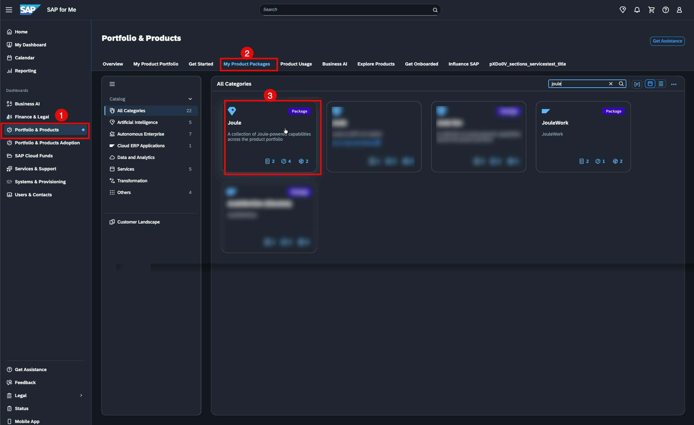

# Getting Started - Explore Landscapes

In this exercise, you will familiarize yourself with the two landscapes used throughout this session: the SAP-managed environment (BAIP) and Google Cloud. Understanding these environments and how they relate to each other is the foundation for all subsequent exercises.

## Overview

After completing these steps you will have:
- An overview of the SAP-managed landscape and its key components (Joule Studio, SAP's Agent Gateway, Cloud Identity Service)
- An overview of the Google Cloud landscape (Gemini Enterprise, Agent Platform)
- Understood the end-to-end architecture: how a Gemini agent will eventually call through SAP's Agent Gateway to a custom Joule agent

## Step 1 - Explore the Architecture

Before diving into the hands-on setup, familiarize yourself with the reference architectures that describe what you will build today.

1. Open the **SAP Architecture Center** at [architecture.learning.sap.com](https://architecture.learning.sap.com).

2. Search for and explore the following two reference architectures:
   - **AI Agents & Business AI Platform** — the foundational architecture for SAP's agent ecosystem
   - **Integrating AI Agents into the Google Ecosystem** — describes how external agents (like Gemini) connect to SAP agents through the Agent Gateway

3. As you read, look for the components you will configure in the exercises ahead: Joule Studio, SAP's Agent Gateway, and SAP Cloud Identity Services.

Solution — reference architecture links

- [AI Agents & Business AI Platform](https://architecture.learning.sap.com/docs/ref-arch/98efa0)
- [Integrating AI Agents into the Google Ecosystem](https://architecture.learning.sap.com/docs/ref-arch/fe0d1d)

## Step 2 - Explore the SAP-managed Landscape (BAIP)

In this step you will navigate the SAP-managed landscape and identify the key components.

1. Open the SAP for Me portal and navigate to your assigned system.

2. Locate the following services and note their URLs for later use:
   - **Joule Work** (including Joule Studio and SAP's Agent Gateway)
   - **SAP Cloud Identity Service**

## Step 3 - Explore the Google Cloud Landscape

In this step you will navigate the Google Cloud Console and identify the Gemini Enterprise and Agent Platform components.

1. Open the Google Cloud Console and switch to your assigned project.

2. Locate **Gemini Enterprise** and **Agent Platform** in the navigation. Note which region your project is deployed in.

## Summary

You now have a clear picture of both landscapes and the key components you will work with.

Continue to - [Exercise 1 - Create a Custom Agent in Joule Studio](../ex1/README.md)
