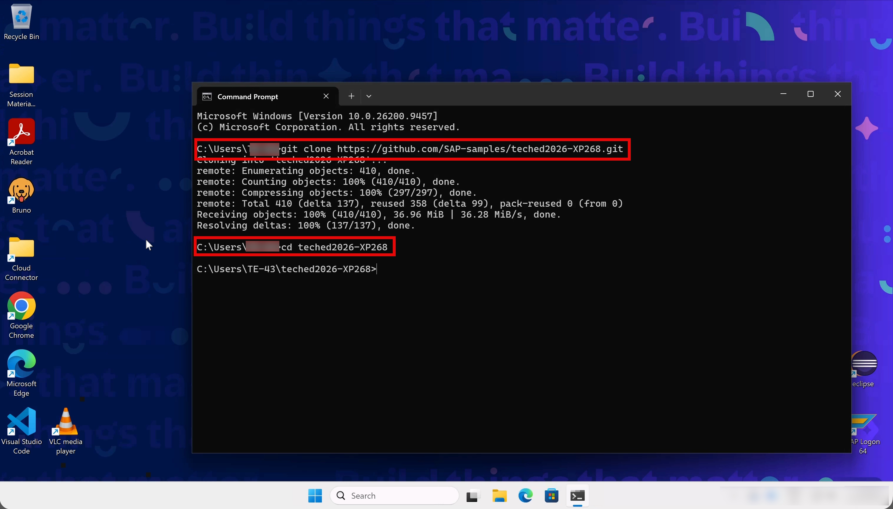
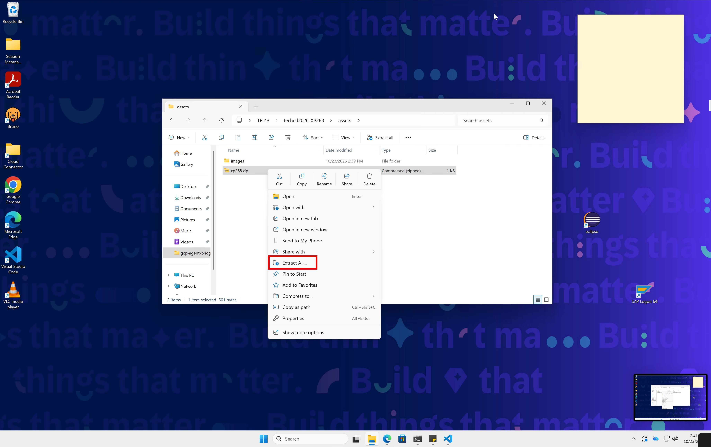
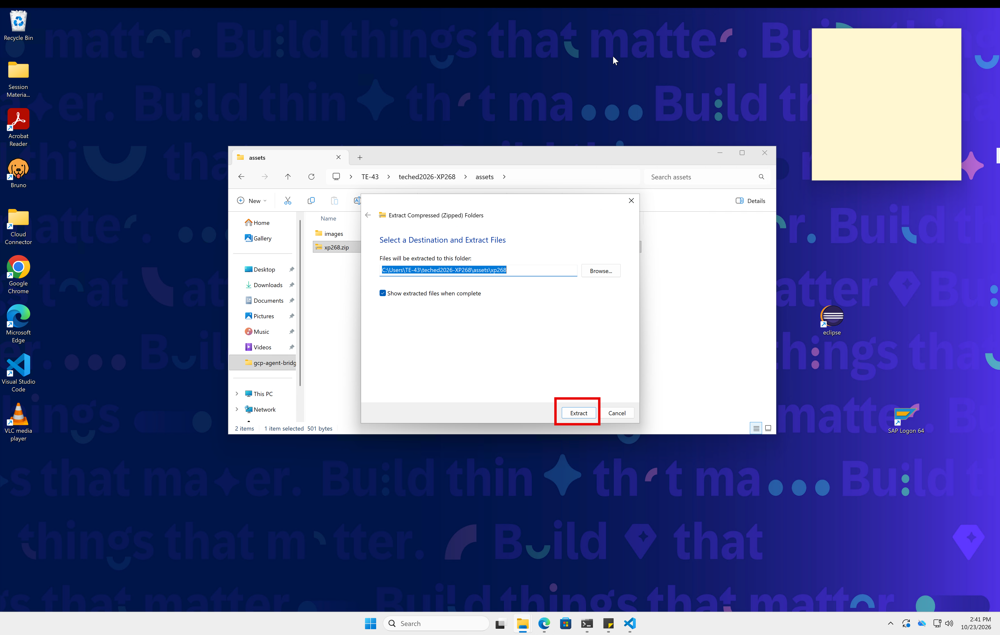
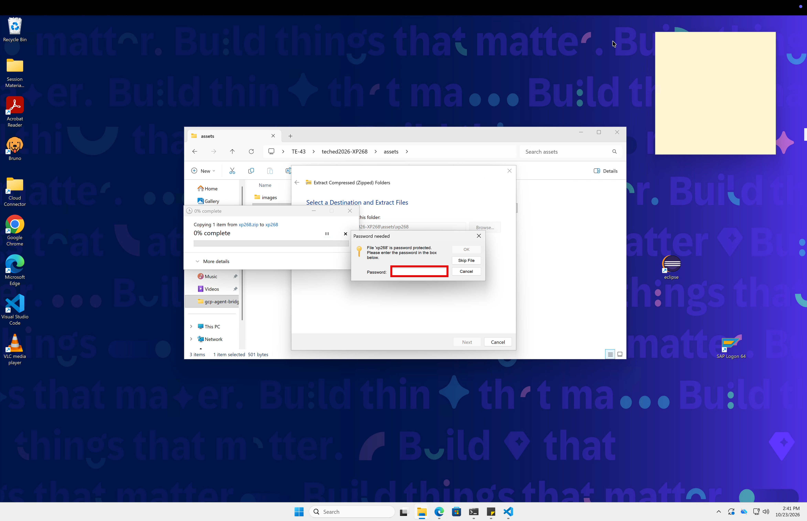
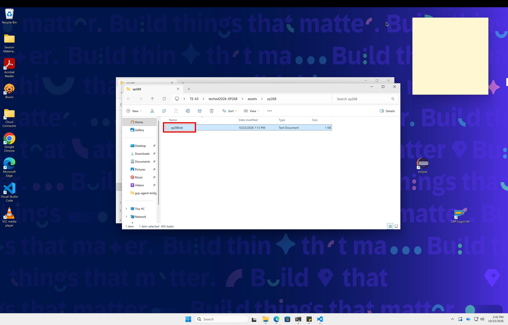
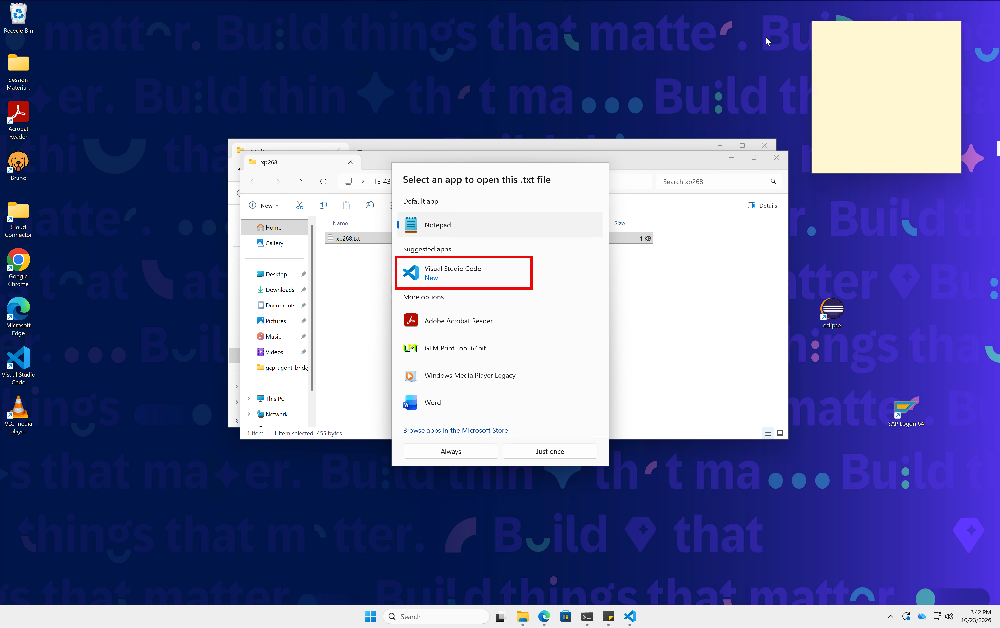
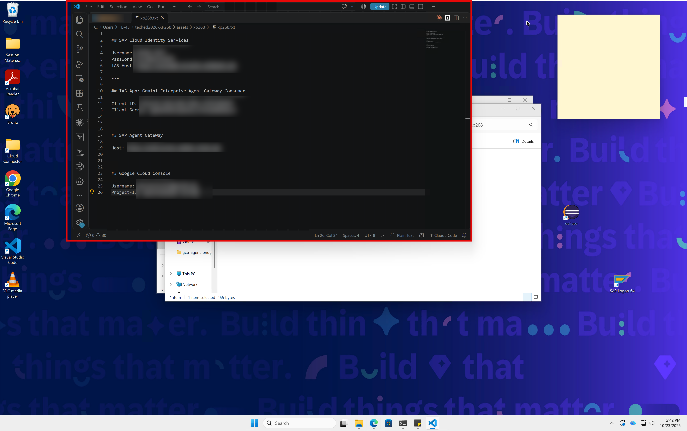

# Getting Started - Explore Landscapes

In this exercise, you familiarize yourself with the two landscapes used throughout this session — SAP Business AI Platform and Google Cloud — and the story that connects them. Understanding these environments is the foundation for all subsequent exercises.

## Overview

After completing these steps you will have:
- An overview of the Business AI Platform and the components relevant to this session (SAP's Agent Gateway, SAP Cloud Identity Services, and the already-deployed Joule agent)
- An overview of the Google Cloud landscape (Gemini Enterprise, Agent Platform)
- Understood the end-to-end architecture: how a Gemini agent will eventually call through SAP's Agent Gateway to a Joule agent

## Clone this Repository

The exercises use Bruno API collections and configuration files from this repository. Clone it to your local machine before proceeding.

1. Open a Terminal or the Command Prompt and run:

```bash
git clone https://github.com/SAP-samples/teched2026-XP268.git
cd teched2026-XP268
```
<br>

2. You will point the Bruno API client at this repository's collection in Exercise 2, and run CLI commands from this directory in Exercise 3 — so keep the terminal handy.

3. Get your logins and variables

- Open the cloned `teched2026-XP268` repository folder (note the location in Terminal) and extract the archive `xp268.zip` by right-clicking and selecting `Extract All...`

- Continue with `Extract`

- You will be prompted for a password, which you get from your session speakers - enter it and click `OK`

- Open the extracted file `xp268.txt`

- Choose Visual Studio Code

- Here we go - keep this file open throughout the workshop, as you will need it again and again


## Explore the Architecture

Before diving into the hands-on steps, familiarize yourself with the reference architectures that describe what you will work with today.

1. Open the **SAP Architecture Center** at [architecture.learning.sap.com](https://architecture.learning.sap.com).

2. Search for and explore the following two reference architectures:
   - **Agentic AI & AI Agents on SAP Business AI Platform** — the foundational architecture for SAP's agent ecosystem
   - **Gemini Enterprise Integration with Joule Agents** — describes how Gemini Enterprise connects to SAP agents through SAP's Agent Gateway

3. As you read, look for the components you will encounter in the exercises ahead: SAP's Agent Gateway, Joule Agents out of the Autonomouse Enterprise and Gemini Enterprise.

<details>
<summary>Solution — SAP Architecture Center links</summary>

- [Agentic AI & AI Agents on SAP Business AI Platform](https://architecture.learning.sap.com/docs/ref-arch/98efa0)
- [Integrating Joule Agents into Your Ecosystem - Gemini Enterprise Integration with Joule Agents](https://architecture.learning.sap.com/docs/ref-arch/c9a3f8)

</details>

## Summary

You now have a clear picture of the end-to-end architecture and the key components you will work with.

Continue to - [Exercise 2 - Call the Joule Agent via SAP's Agent Gateway](../ex2/README.md)
