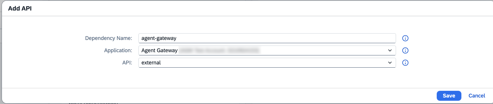
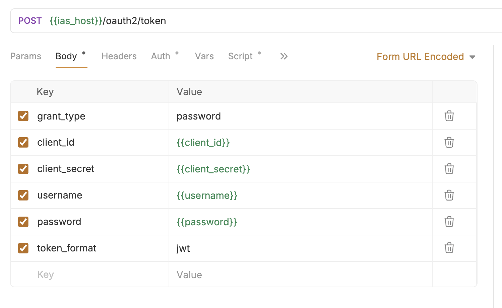
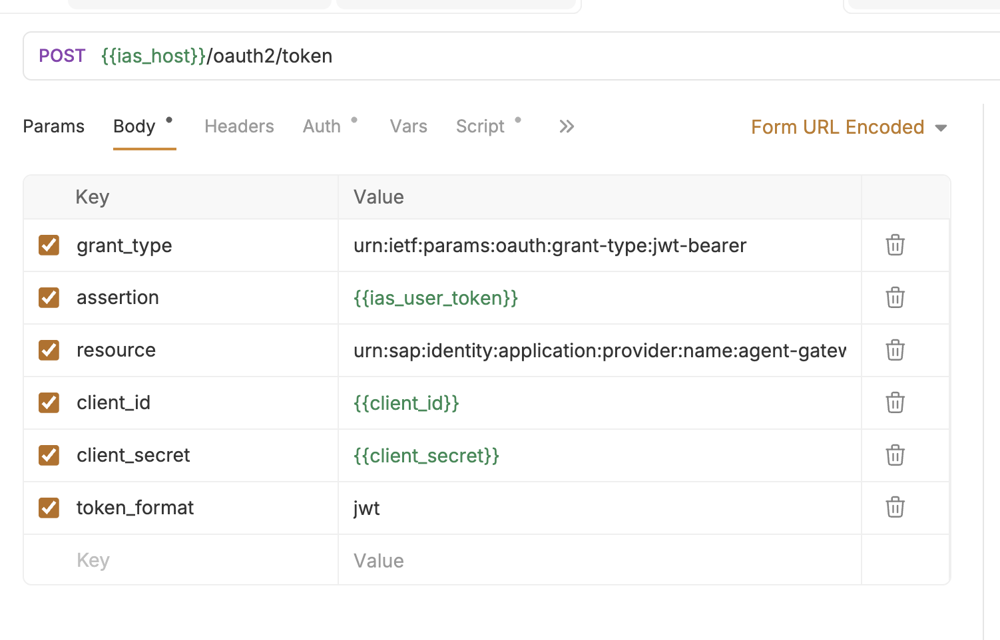

# Exercise 2 - Call the Custom Agent via SAP's Agent Gateway

In this exercise, you will first explore the Agent Gateway Consumer client setup in SAP for Me and Cloud Identity Services, then use Bruno to call your custom Joule agent through SAP's Agent Gateway.

## Exercise 2.1 - SAP for Me: Creating an Agent Gateway Consumer System

Reference documentation: [Creating an Agent Gateway Consumer System](https://help.sap.com/docs/CROSS_DOMAIN_AGENTS/4d8be6737cf24797bf753cbcc6e2288f/a0465991ba964736a781c275ddd852db.html?ai=true).

You create an agent gateway consumer system in SAP for Me to represent the external agent that you want to integrate with SAP agents through the agent gateway. This establishes the agent's identity record and is referenced by all subsequent formation assignments.

### Creating the System

1. Log in to **SAP for Me** with your cloud administrator credentials.

2. Navigate to **Portfolio & Products** > **My Product Packages** > **Joule** > **Customer Landscape** > **Systems**.

3. Create a new system of type **Agent Gateway Consumer** with the following settings:

   | Field | Value |
   |---|---|
   | **System Type** | Agent Gateway Consumer |
   | **Resource URL** | leave blank |
   | **JWKS Endpoint URL** | leave blank |
   | **Name** | `XP268-{YOUR-NUMBER}-AGW-Consumer` |
   | **Application Identifier** | e.g. `xp268-{your-number}` |

4. Confirm that the system is created successfully. The system name identifies the third-party agent in all subsequent formations.

### Assigning the System to Formations

Three formations must be assigned in order. Each formation produces a configuration that the next depends on — do not create Formation 2 before Formation 1 reaches `READY` state, and do not create Formation 3 before Formation 2 reaches `READY` state.

**Formation 1: Integration with SAP Cloud Identity Services**

1. Navigate to the **Formations** tab.
2. Find the formation of type **Integration with SAP Cloud Identity Services** (e.g. `sap-sci<your-formation-id>`). Click **Include Systems**.
3. Select your `XP268-{YOUR-NUMBER}-AGW-Consumer` system and click **Next Step**.
4. Review the selected system and click **Include**.

> **Result:** A single-tenant OIDC application representing your system is created in SAP Cloud Identity Services, establishing the agent's identity.

**Formation 2: Integration with Agent Gateway**

> ⚠️ **Known issue:** Adding the Agent Gateway Consumer system to this formation is currently not working in the workshop environment. You can skip this step — the workaround in Exercise 2.2 compensates for the missing formation dependency.

1. Find the formation of type **Integration with Agent Gateway** (e.g. `sap-agw<your-formation-id>`). Click **Include Systems**.
2. Select your `XP268-{YOUR-NUMBER}-AGW-Consumer` system and click **Next Step**.
3. Review and click **Include**.

> **Result:** The dependency between the agent's identity and the agent gateway is established, enabling your system to call SAP agents through the agent gateway.

**Formation 3: Integration with Agent Gateway Consumer** *(must be created, it does not exist yet)*

1. Click **Create Formation**.
2. Enter a **Formation Name** (e.g. `XP268-{YOUR-NUMBER}-Agent-Integration`), set **Formation Type** to **Integration with Agent Gateway Consumer**, and click **Next Step**.
3. Select the **Agent Gateway** system and click **Next Step**.
4. Select your `XP268-{YOUR-NUMBER}-AGW-Consumer` system (System Type: Agent Gateway Consumer) and click **Next Step**.
5. Select the SAP agents and/or assistants you want your system to be able to invoke — this includes your custom Joule agent deployed via Joule Studio. Click **Next Step**.

> **Result:** Formation 3 is created with all three systems included, establishing the allow list of SAP agents your consumer is permitted to invoke.

## Exercise 2.2 - SAP Cloud Identity Services: Configure the Agent Gateway Consumer

Reference documentation: [Configuring Client Credentials-Based Access for Third-Party Agents](https://help.sap.com/docs/CROSS_DOMAIN_AGENTS/4d8be6737cf24797bf753cbcc6e2288f/72cdc81ab3c648268dda8a16ad547453.html?ai=true) and [Generating the Client Credentials](https://help.sap.com/docs/CROSS_DOMAIN_AGENTS/4d8be6737cf24797bf753cbcc6e2288f/72cdc81ab3c648268dda8a16ad547453.html?ai=true).

1. Open your Cloud Identity Services instance and search for the Agent Gateway Consumer application named `XP268-{YOUR-NUMBER}-AGW-Consumer`. This is the application that was created through SAP for Me once the Agent Gateway Consumer System was included in the formation **Integration with SAP Cloud Identity Services**.

   After selecting the application, follow the screenshots and choose **Client Authentication**. In the Secrets section, click **Add**.

2. Add a secret with the API access settings **Application** and **OpenID**.

3. Note down the **Client ID** and **Client Secret**. The Client Secret will not be displayed again after you close the pop-up.

4. **Additional step:** Since the Agent Gateway Consumer system could not be included in the SAP for Me formation **Integration with Agent Gateway**, perform the following workaround outside the official documentation:
   - Navigate to the application's **Dependencies**.
   - Add a new dependency with:
     - Application: **Agent Gateway…**
     - API name: **external**

## Exercise 2.3 - Test the Call Chain with Bruno

After completing these steps you will have successfully called your custom Joule agent through SAP's Agent Gateway using the Agent Gateway Consumer.

1. Open Bruno and import the provided collection from `exercises/ex2/bruno/`.

2. Configure the environment variables in Bruno with your credentials:
   - `ias_host` — your IAS tenant URL
   - `client_id` and `client_secret` — noted down in Exercise 2.2
   - `username` and `password` — your SAP Cloud Identity Services user credentials
   - `agw_endpoint` — your Agent Gateway endpoint from Exercise 1.2

3. Run the **Fetch User Token** request. It sends a `password` grant to `{{ias_host}}/oauth2/token` and returns a JWT access token.
 

4. Run the **Exchange User Token** request. It performs a JWT bearer grant (`urn:ietf:params:oauth:grant-type:jwt-bearer`) using the token from step 3 as the `assertion`, scoped to the Agent Gateway resource, and returns a new JWT token bound to the Agent Gateway.
 

5. Run the **Fetch Agent Card** request. It sends a GET to `{{agent_gateway_host}}/v1/a2a/{{agent_ord}}/{{agent_tenant}}/.well-known/agent-card.json` with the exchanged token as a Bearer Token, and returns the agent's capability descriptor.
 

6. Run the **Invoke Agent** request. It sends an A2A (Agent-to-Agent Protocol) call as a JSON-RPC 2.0 `message/send` to `{{agent_gateway_host}}/v1/a2a/{{agent_ord}}/{{agent_tenant}}/jsonrpc` with a user message — feel free to change the `text` field to something of your own. Inspect the response and verify your custom Joule agent replied correctly.
 

## Summary

You've now explored the Agent Gateway Consumer setup in SAP for Me and Cloud Identity Services, and successfully called your custom Joule agent through SAP's Agent Gateway.

Continue to - [Exercise 3 - Configure Connection from Gemini Enterprise Agent](../ex3/README.md)
