# Exercise 2 - Call the Joule Agent via SAP's Agent Gateway

In this exercise you call a Joule agent through SAP's Agent Gateway. The setup in SAP for Me and SAP Cloud Identity Services was **completed in advance on your behalf** — you cannot perform it live in the workshop, but you will **read through** what was configured so you understand the trust chain. You then discover the callable agent via [Agent Resource Discovery (ARD)](https://agenticresourcediscovery.org/) and invoke it with the [Bruno API client](https://www.usebruno.com/).

The sub-steps:
- **2.1 & 2.2** — *read-through*: understand the Agent Gateway Consumer and the SAP Cloud Identity Services OIDC application that were created for you.
- **2.3** — *discover*: use ARD to find which agents are callable and read the identifiers you need.
- **2.4** — *call*: invoke the agent end-to-end in Bruno.

## Exercise 2.1 - SAP for Me: Creating an Agent Gateway Consumer System

> **Read-through only.** The steps below were already performed in advance for your workshop tenant — you are not expected (and will not have the access) to do them live. Read them to understand how the external agent's identity was established. The full procedure is documented in the official SAP Help tutorial: [Creating an Agent Gateway Consumer System](https://help.sap.com/docs/CROSS_DOMAIN_AGENTS/4d8be6737cf24797bf753cbcc6e2288f/f6f218644e704192b3a9b7af0f5794b4.html).

An agent gateway consumer system in SAP for Me represents the external agent that is integrated with SAP agents through the SAP's Agent Gateway. It establishes the agent's identity record and is referenced by all subsequent formation assignments.

### Creating the System

1. Log in to **SAP for Me** with your cloud administrator credentials.

2. Navigate to **Portfolio & Products** > **My Product Packages** > **Joule** > **Customer Landscape** > **Systems**.


3. Create a new system of type **Agent Gateway Consumer** with the following settings:

   | Field | Value |
   |---|---|
   | **System Type** | Agent Gateway Consumer |
   | **Resource URL** | leave blank |
   | **JWKS Endpoint URL** | leave blank |
   | **Name** | `XP268-AGW-Consumer` |
   | **Application Identifier** | e.g. `xp268` |

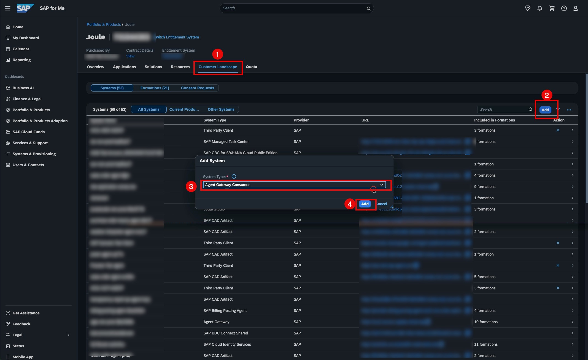
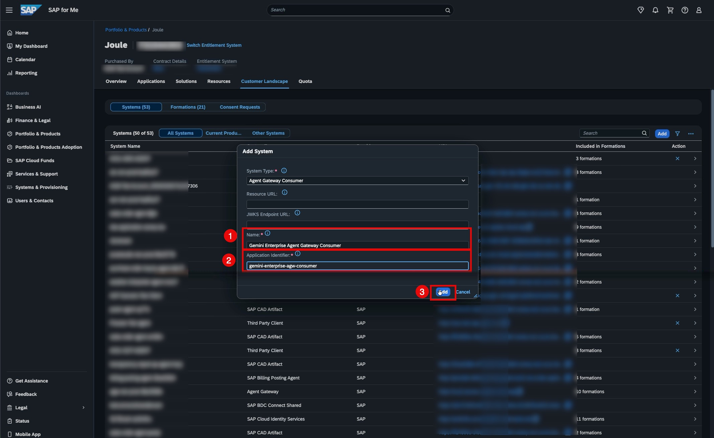

4. Confirm that the system is created successfully. The system name identifies the third-party client (Agent Gateway Consumer) in all subsequent formations.

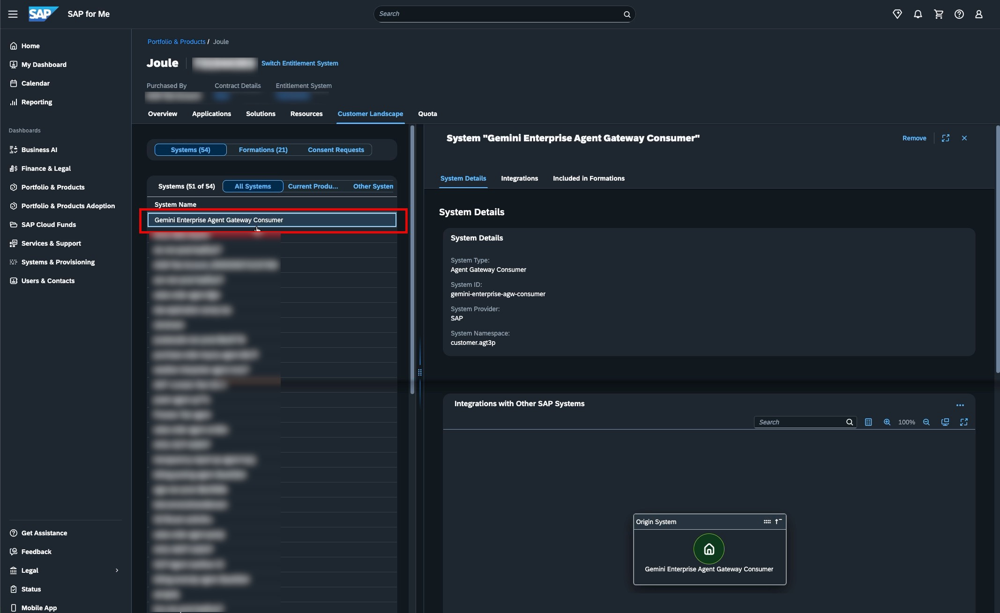

### Assigning the System to Formations

Three formations must be assigned in order. Each formation produces a configuration that the next depends on — do not create Formation 2 before Formation 1 reaches `READY` state, and do not create Formation 3 before Formation 2 reaches `READY` state.

**Formation 1: Integration with SAP Cloud Identity Services**

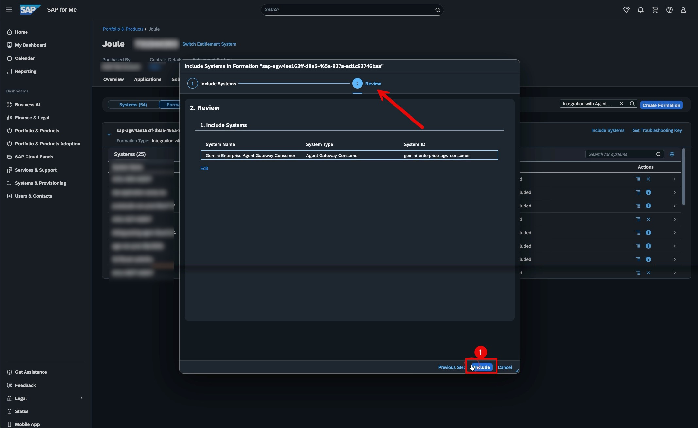

1. Navigate to the **Formations** tab.
<<<<<<< HEAD
2. Find the formation of type **Integration with SAP Cloud Identity Services** (e.g. `sap-sci<your-formation-id>`). Click **Include Systems**.
3. Select your `XP268-AGW-Consumer` system and click **Next Step**.
=======
2. Find the formation of type **Integration with SAP Cloud Identity Services**. Click **Include Systems**.
3. Select your `Gemini Enterprise Agent Gateway Consumer` system and click **Next Step**.
>>>>>>> discovery
4. Review the selected system and click **Include**.

> **Result:** A single-tenant OIDC application representing your system is created in SAP Cloud Identity Services, establishing the agent's identity.

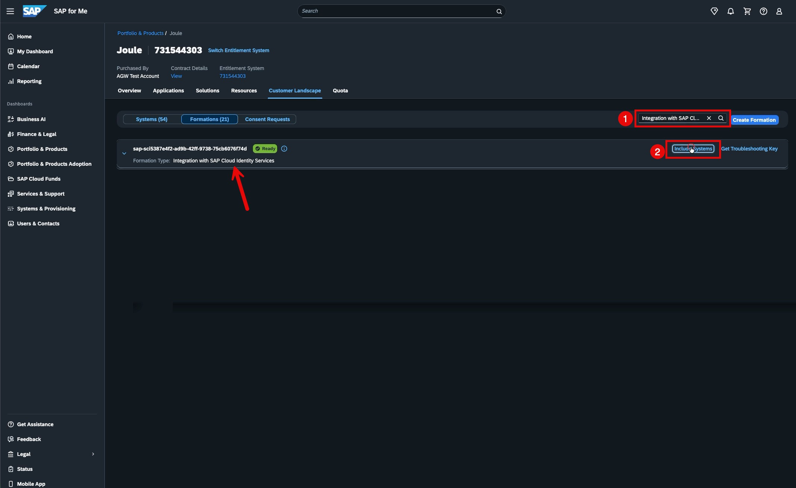
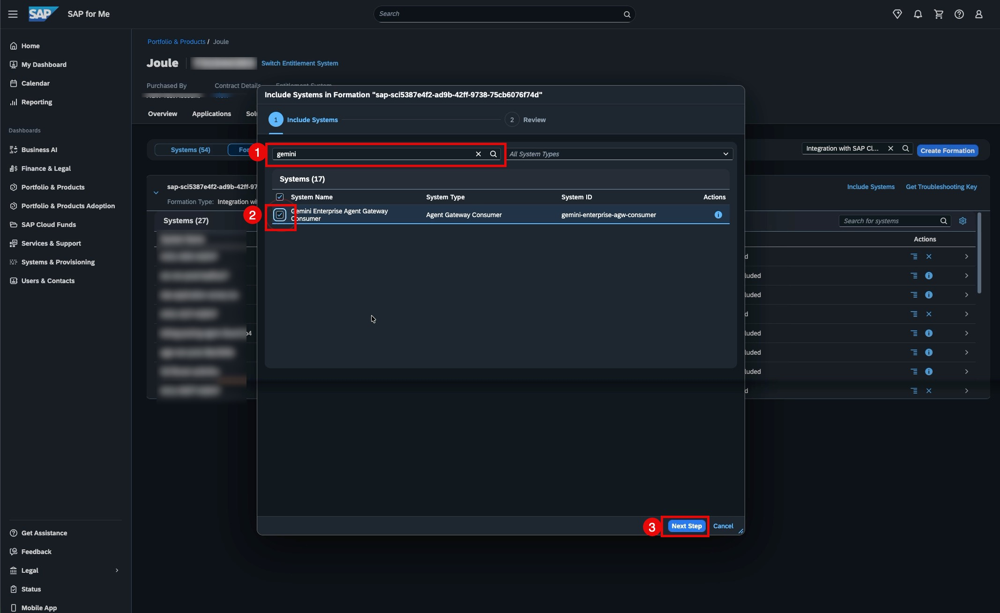
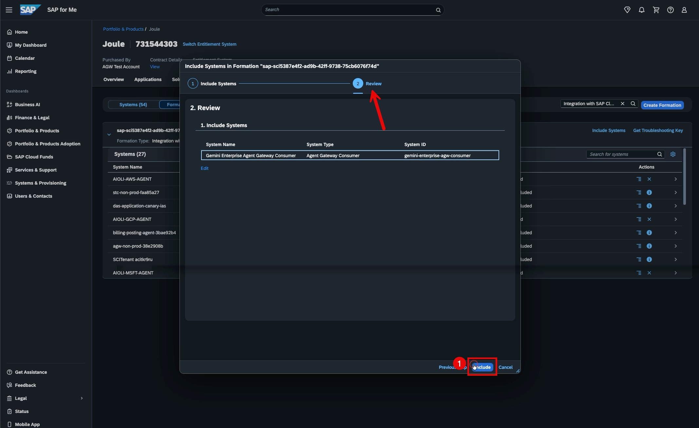

**Formation 2: Integration with Agent Gateway for Third Party**

1. Click **Create Formation**.
<<<<<<< HEAD
2. Enter a **Formation Name** (e.g. `XP268-Agent-Gateway-Integration`), set **Formation Type** to **Integration with Agent Gateway for Third Party**, and click **Next Step**.
3. Select the **Agent Gateway** system and click **Next Step**.
4. Select your `XP268-AGW-Consumer` system (System Type: Agent Gateway Consumer) and click **Next Step**.
5. Select the **SAP Cloud Identity** system.
6. Click **Next Step**, review and **Create**.
=======
2. Enter a **Formation Name** (e.g. `Agent Gateway for Third Party`), set **Formation Type** to **Integration with Agent Gateway for Third Party**, and click **Next Step**.
3. Select the **Agent Gateway** system, **SAP Cloud Identity** system and your `Gemini Enterprise Agent Gateway Consumer` system (System Type: Agent Gateway Consumer) and click **Next Step**.
4. Review and **Create**.
>>>>>>> discovery

> **Result:** The dependency between the agent's identity and the agent gateway is established, enabling your system to call SAP agents through the agent gateway.

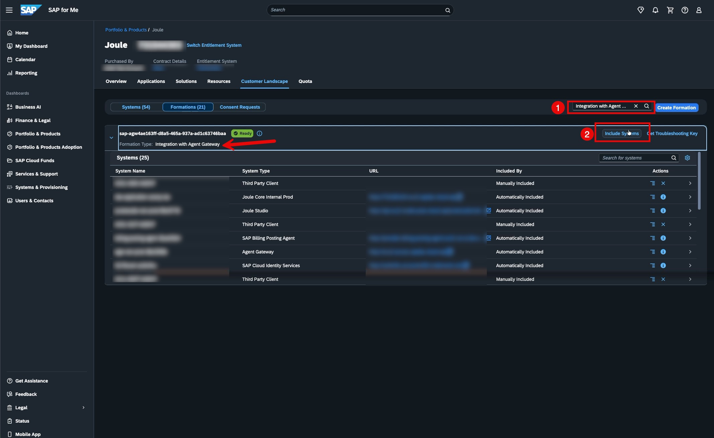
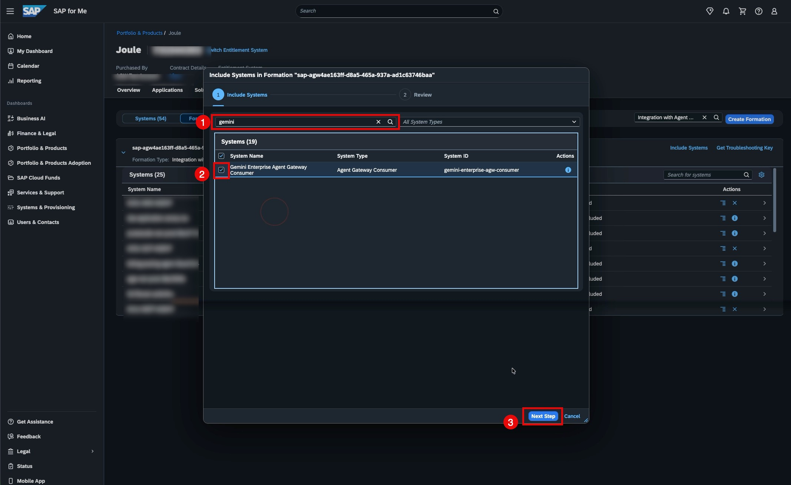

**Formation 3: Integration with Agent Gateway Consumer**

1. Click **Create Formation**.
<<<<<<< HEAD
2. Enter a **Formation Name** (e.g. `XP268-Agent-Integration`), set **Formation Type** to **Integration with Agent Gateway Consumer**, and click **Next Step**.
3. Select the **Agent Gateway** system.
4. Select your `XP268-AGW-Consumer` system (System Type: Agent Gateway Consumer).
5. Select the SAP agents and/or assistants you want your system to be able to invoke.
6. Click **Next Step**, review and **Create**.
=======
2. Enter a **Formation Name** (e.g. `Gemini Enterprise Agent Gateway Consumer`), set **Formation Type** to **Integration with Agent Gateway Consumer**, and click **Next Step**.
3. Select the **Agent Gateway** system and your `Gemini Enterprise Agent Gateway Consumer` system (System Type: Agent Gateway Consumer).
4. Select the SAP agents and/or assistants you want your system to be able to invoke.
5. Click **Next Step**, review and **Create**.
>>>>>>> discovery

> **Result:** Formation 3 is created with the systems included, establishing the allow list of SAP agents your Agent Gateway Consumer is permitted to invoke.

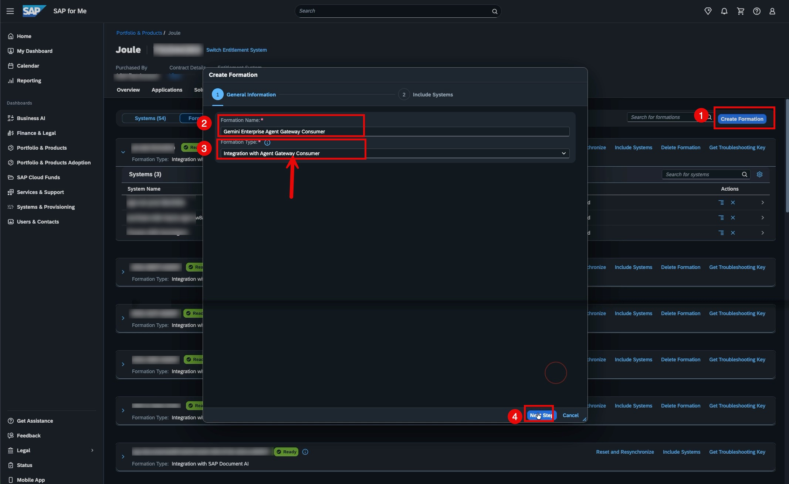
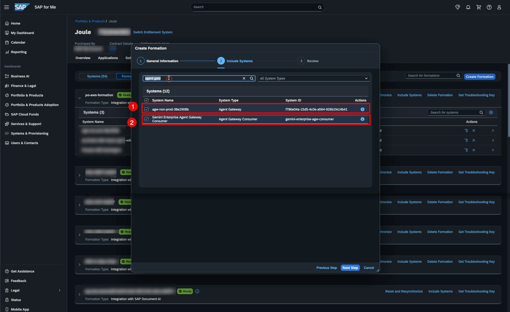
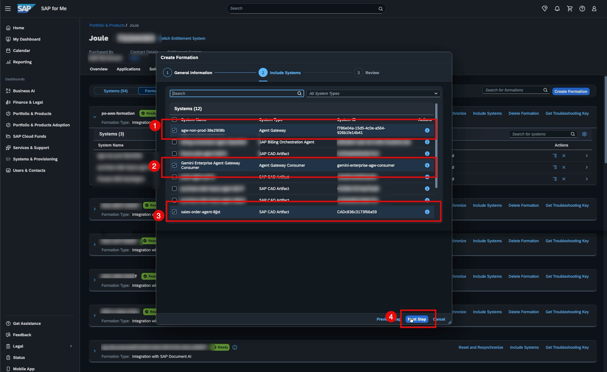
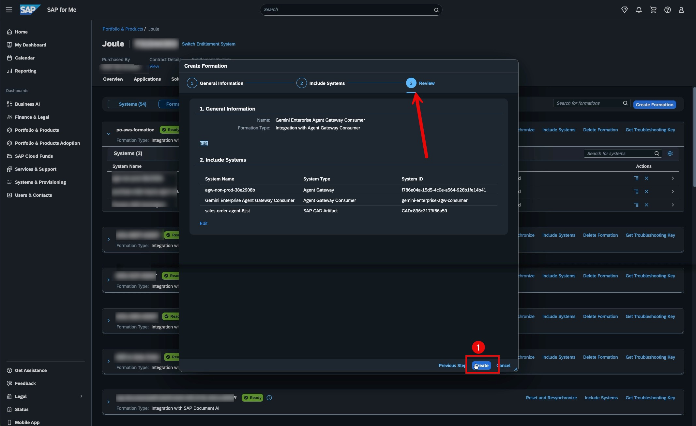

## Exercise 2.2 - SAP Cloud Identity Services: Configure the Agent Gateway Consumer

> **Read-through only.** As with 2.1, this configuration was done in advance. The resulting **Client ID** and **Client Secret** are **provided to you** for the workshop — you will not generate them live. Read through to understand where these credentials come from and how the Agent Gateway trusts your Agent Gateway Consumer. Reference documentation: [Configuring Client Credentials-Based Access for Third-Party Agents](https://help.sap.com/docs/CROSS_DOMAIN_AGENTS/4d8be6737cf24797bf753cbcc6e2288f/72cdc81ab3c648268dda8a16ad547453.html?ai=true).

When the Agent Gateway Consumer system was included in the **Integration with SAP Cloud Identity Services** formation, a single-tenant OIDC application named `XP268-AGW-Consumer` was created in SAP Cloud Identity Services. That application carries the client credentials used to obtain tokens.

1. In SAP Cloud Identity Services, the Agent Gateway Consumer application named `XP268-AGW-Consumer` is selected. Under **Client Authentication** → **Secrets**, a secret is added.
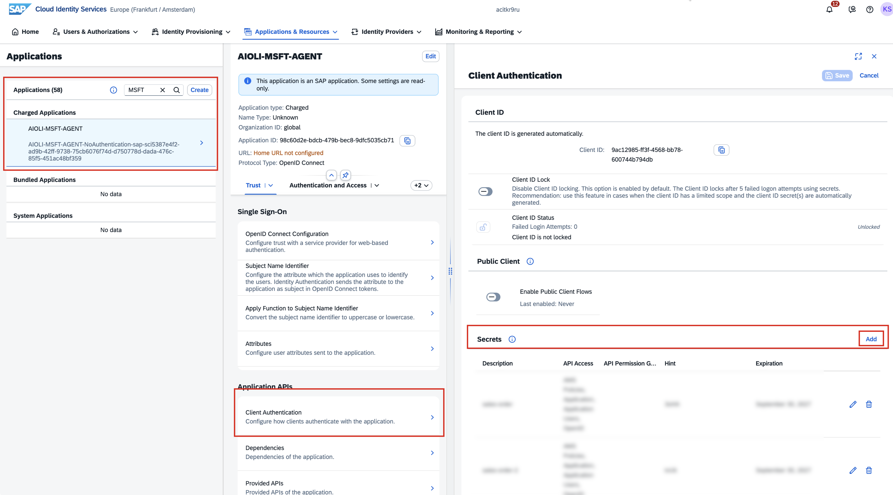

2. The secret is added with the API access settings **Application** and **OpenID**.
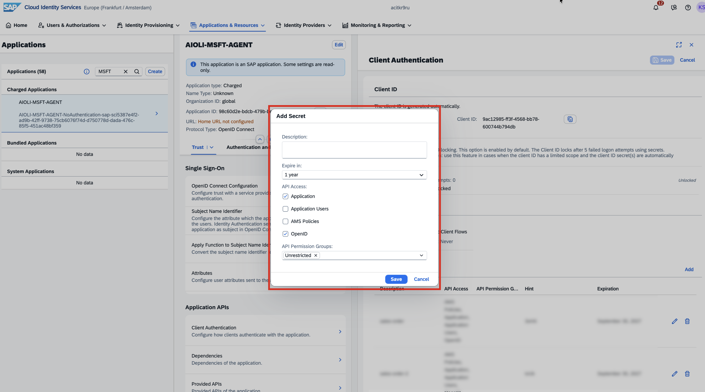

3. The **Client ID** and **Client Secret** are captured here. In the workshop these values are **handed to you** — the secret is only shown once at creation time and cannot be retrieved again afterwards.
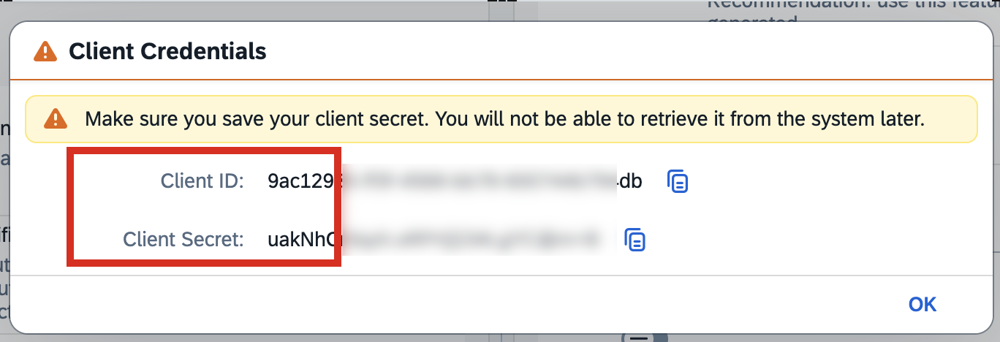

4. Under **Dependencies**, you can see the trust relationship to the **Agent Gateway** (API name: **external**) that was established by Formation 2. This dependency is what allows your application to request a token scoped to the Agent Gateway resource (`urn:sap:identity:application:provider:name:agent-gateway`) during the token exchange — which you will do in Exercise 2.4.

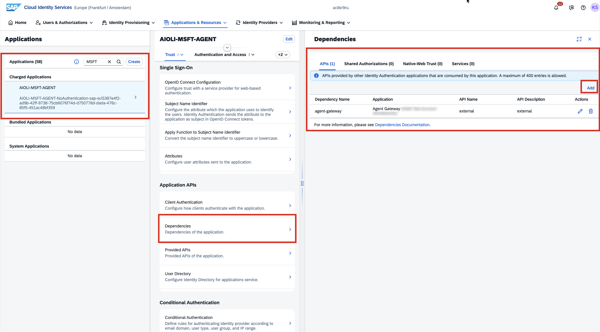

## Exercise 2.3 - Discover the Agent via ARD

Before you can call an agent, you need to know **which** agents are reachable through the Agent Gateway and **which of them are callable**. SAP's Agent Gateway exposes an **Agent Resource Discovery (ARD)** document for exactly this: a catalogue of the agents behind the gateway, each with its identifier, agent-card URL, and metadata. The ARD document is the high-level overview; the **agent card** of the callable agent then gives you the specific details — including the A2A endpoint you need to invoke it.

You run discovery with the provided Bruno collection, starting from the same OAuth token flow you will reuse to invoke the agent.

1. Open Bruno and open the provided collection from [`exercises/ex2/bruno/`](./bruno/) (if not already imported). 
<br>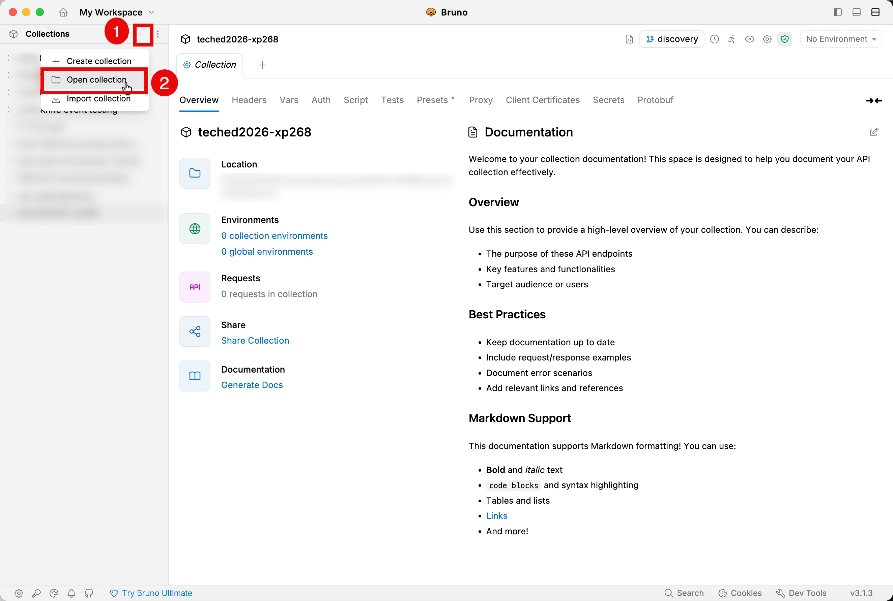
Select the folder [`exercises/ex2/bruno/`](./bruno/)

    Configure the environment variables:
    <br>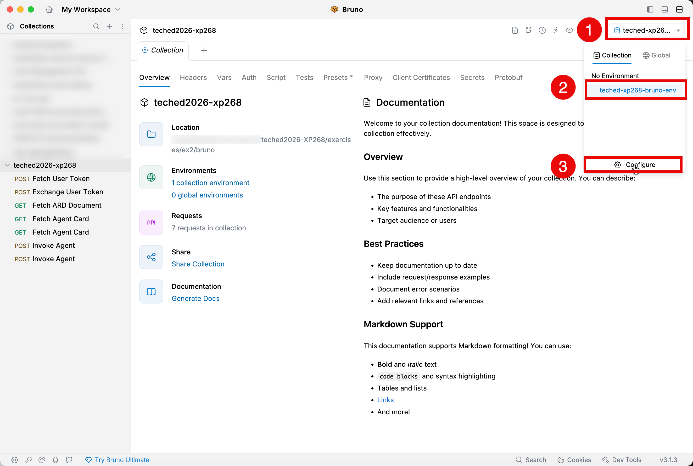
    <br>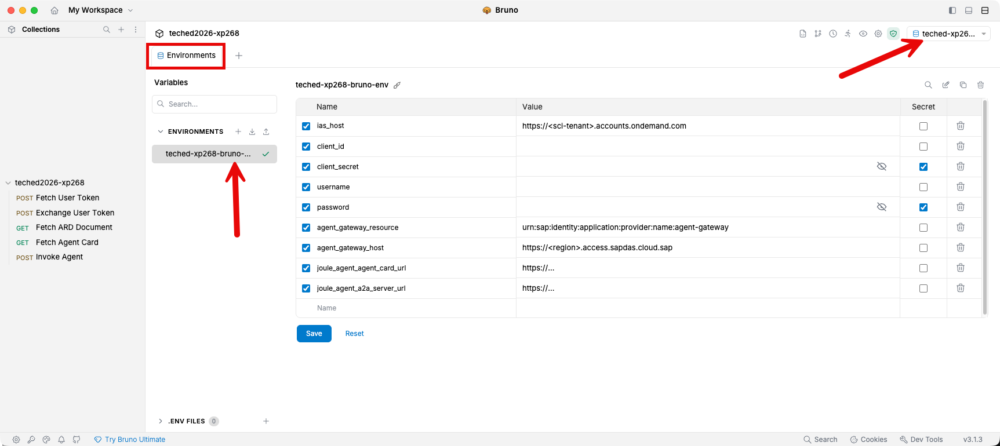

Add or adjust the following entries:
   - `ias_host` — your SAP Cloud Identity Services tenant URL
   - `client_id` and `client_secret` — the credentials handed to you in [Exercise 2.2](./README.md#exercise-22---sap-cloud-identity-services-configure-the-agent-gateway-consumer)
   - `username` and `password` — your SAP Cloud Identity Services user credentials
   - `agent_gateway_host` — your Agent Gateway endpoint

2. Run **(1) Fetch User Token**-Call. *Fetch User Token* sends a `password` grant to `{{ias_host}}/oauth2/token` and returns a JWT access token.
<br>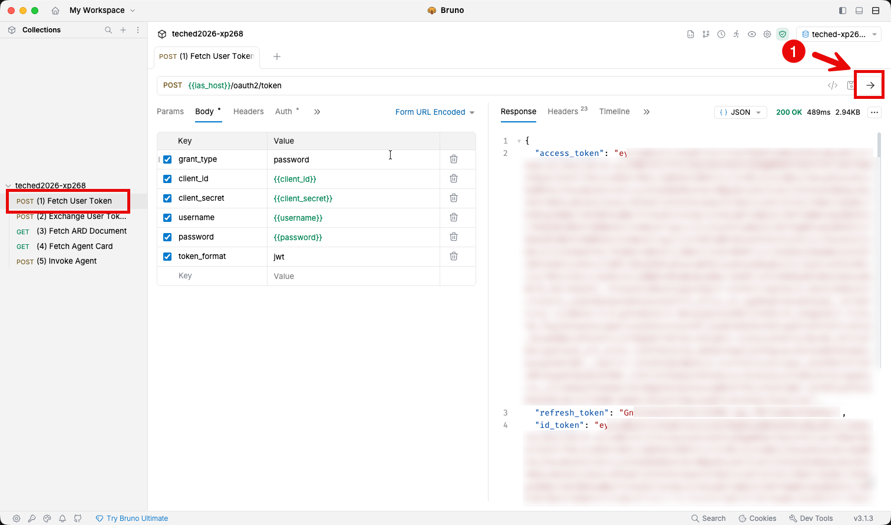

3. Then run **(2) Exchange User Token**. ; *Exchange User Token* performs a JWT bearer grant (`urn:ietf:params:oauth:grant-type:jwt-bearer`) scoped to the Agent Gateway resource. The exchanged token is stored as `agent_gateway_token` and reused by the upcoming requests.
<br>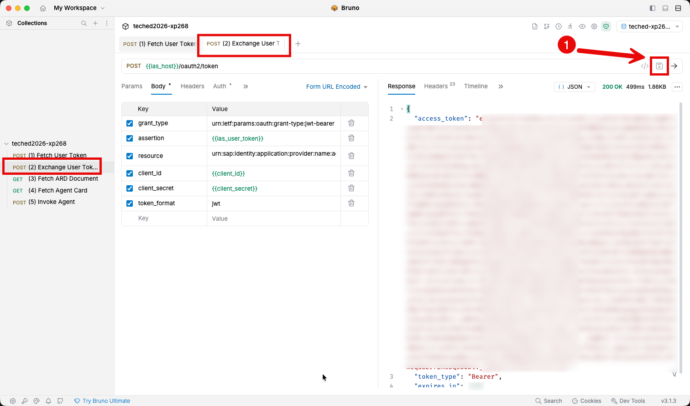

4. Run the **(3) Fetch ARD Document** request. It sends a GET to `{{agent_gateway_host}}/v1/.well-known/ard.json` with the exchanged token as a Bearer Token and returns the discovery document.
<br>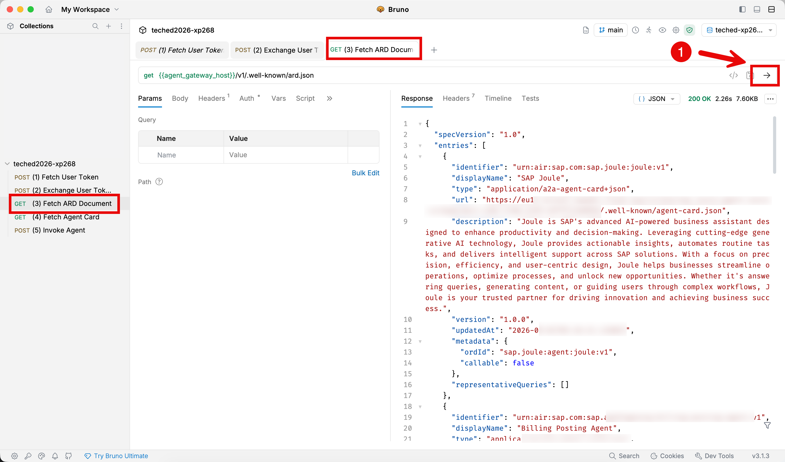

5. Inspect the response. It has the shape:

   ```json
   {
     "specVersion": "1.0",
     "entries": [
       {
         "identifier": "urn:air:sap.com:sap.joule:agent1:v1",
         "displayName": "SAP Joule Agent 1",
         "type": "application/a2a-agent-card+json",
         "url": "https://eu10.access.sapdas.cloud.sap/v1/a2a/sap.joule:agent1:v1/ba8c48c3-c204-4786-a194-e5fefc2abb9a/.well-known/agent-card.json",
         "version": "1.0.0",
         "metadata": {
           "ordId": "sap.joule:agent1:v1",
           "callable": false
         }
       },
       {
         "identifier": "urn:air:sap.com:sap.joule:agent2:v1",
         "displayName": "SAP Joule Agent 2",
         "type": "application/a2a-agent-card+json",
         "url": "https://eu10.access.sapdas.cloud.sap/v1/a2a/sap.joule:agent2:v1/cb4c48c3-c204-3786-a094-a6fefb2ebfff/.well-known/agent-card.json",
         "metadata": {
           "ordId": "sap.joule:agent2:v1",
           "callable": true
         }
       },
       ...
     ]
   }
   ```
    [Agentic Resource Discovery Specification (ARD)](https://agenticresourcediscovery.org/) is an open discovery protocol for agentic resources ([GitHub](https://github.com/ards-project/ard-spec)). It allows an AI client to ask: "What is available for this task?" and lets a discovery service answer with matching resources.

6. Find the entry whose `metadata.callable` is `true` — that is the agent you are allowed to invoke. Note that some entries are **not** callable: `SAP Joule Agent 1` itself has `"callable": false`, while the **SAP Joule Agent 2** is callable (reflect what Systems we have put into the Formation 3 with our Agent Gateway Consumer System).

7. From the callable entry, read its agent-card `url` and set the Bruno environment variable **manually**:
   - `joule_agent_agent_card_url` ← the entry's `url` verbatim (the `.../v1/a2a/<ord>/<tenant>/.well-known/agent-card.json` endpoint)

   For example, given the callable entry's `url`:

   ```
   https://eu10.access.sapdas.cloud.sap/v1/a2a/sap.joule:agent2:v1/cb4c48c3-c204-3786-a094-a6fefb2ebfff/.well-known/agent-card.json
   ```

   you set:

   | Variable | Value |
   |---|---|
   | `joule_agent_agent_card_url` | `https://eu10.access.sapdas.cloud.sap/v1/a2a/sap.joule:agent2:v1/cb4c48c3-c204-3786-a094-a6fefb2ebfff/.well-known/agent-card.json` |

8. The ARD document gave you the high-level catalogue. Now fetch the **agent card** to get the specific details of that agent. Run the **(4) Fetch Agent Card** request — it sends a GET to `{{joule_agent_agent_card_url}}` with the exchanged token as a Bearer Token and returns the agent's capability descriptor.
<br>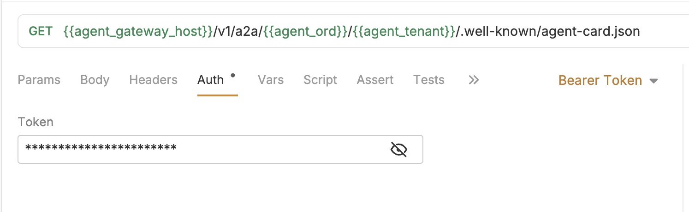

9. In the agent-card response, locate the agent's A2A endpoint — the top-level `url` field of the agent card — and set it on the Bruno environment:
   - `joule_agent_a2a_server_url` ← the agent card's `url` field (the JSON-RPC endpoint, e.g. `<agent_gateway_host>/v1/a2a/<ordId>/<tenant>/jsonrpc`)

   This is the endpoint you invoke in Exercise 2.4.

## Exercise 2.4 - Invoke the SAP Agent with Bruno

With `joule_agent_a2a_server_url` read from the agent card in discovery, you now call the agent end-to-end. After completing these steps you will have successfully called the Joule agent through SAP's Agent Gateway using the Agent Gateway Consumer.

1. Make sure the environment variables from Exercise 2.3 are configured, including `joule_agent_a2a_server_url` read from the agent card.

2. If your `agent_gateway_token` has expired, re-run **Fetch User Token** and **Exchange User Token** to refresh it.

3. Run the **Invoke Agent** request. It sends an A2A (Agent-to-Agent Protocol) call as a JSON-RPC 2.0 `message/send` to `{{joule_agent_a2a_server_url}}` with a user message — feel free to change the `text` field to something of your own. Inspect the response and verify the agent replied correctly.
<br>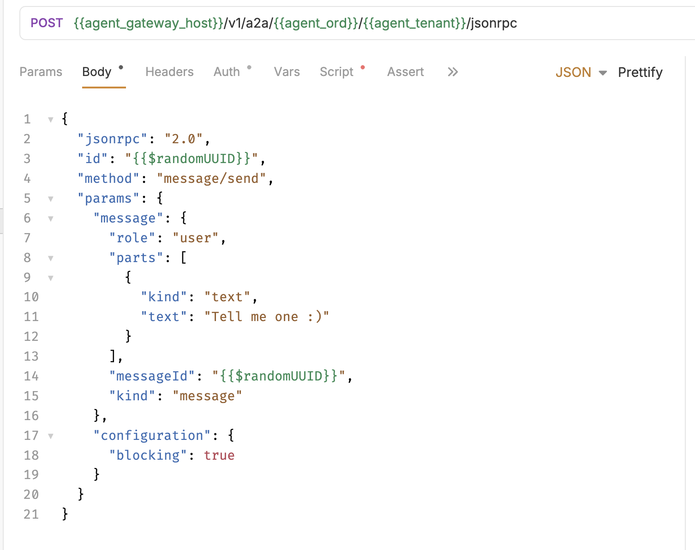

## Summary

You've now read through the Agent Gateway Consumer setup in SAP for Me and SAP Cloud Identity Services, discovered the callable agent via ARD, and successfully called the Joule agent through SAP's Agent Gateway.

Continue to - [Exercise 3 - Configure Connection from Gemini Enterprise Agent](../ex3/README.md)
