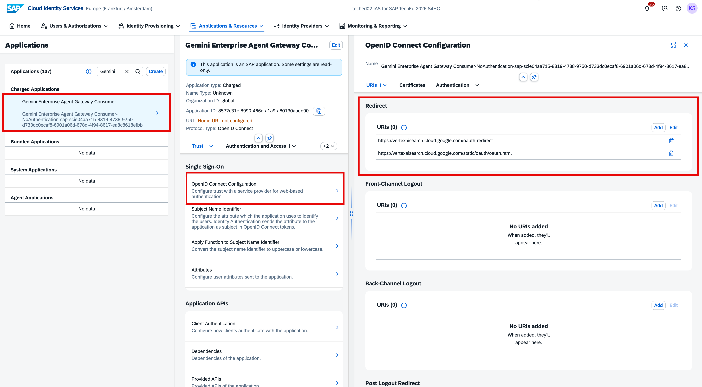

# Exercise 3 - Configure Connection from Gemini Enterprise Agent

In this exercise, you will deploy a bridge agent to Google's Agent Runtime that enables Gemini Enterprise to call your Joule agent through SAP's Agent Gateway using a three-legged OAuth flow.

Gemini Enterprise does support cross-provider three-legged authentication (3LO) with an in-chat sign-in prompt against SAP Cloud Identity Services (IAS). What neither Gemini Enterprise nor SAP offers out of the box is a token exchange that re-scopes the resulting end-user token to the SAP Agent Gateway. That second hop is why the bridge agent is needed. The bridge agent (`gcp-agent-bridge`) sits between Gemini Enterprise and the downstream A2A agent: it exchanges the end-user token forwarded by Gemini Enterprise at SAP Cloud Identity Services — using a client secret — for a downstream-scoped token, then relays the call over A2A.


The agent source lives in [`gcp-agent-bridge/`](./gcp-agent-bridge/). It is a transparent forwarding agent built on the Google ADK and deployed with `agents-cli`. See [`gcp-agent-bridge/README.md`](./gcp-agent-bridge/README.md) for the component-level reference. Because it is a full ADK agent, you could extend it with additional tools, sub-agents, or orchestration logic — for example, combining the SAP Joule agent with other Google or third-party agents to build richer, multi-step workflows.

### How the token exchange works

Understanding the flow makes the SAP Cloud Identity Services configuration below easier to follow:

1. Gemini Enterprise runs the end user's OAuth consent (using the authorization you register in Exercise 3.2) and forwards the resulting user token into the bridge agent's session state.
2. The agent reads that token and calls the SAP Cloud Identity Services token endpoint (`<OAUTH_TOKEN_HOST>/oauth2/token`) with `grant_type=urn:ietf:params:oauth:grant-type:jwt-bearer`, passing the forwarded user token as the `assertion` and the downstream resource as `resource`. This is RFC 7523 **jwt-bearer principal propagation**: SAP Cloud Identity Services re-mints the user token scoped to the downstream, preserving the user's `sub`.
3. The agent authenticates **itself** to SAP Cloud Identity Services with an RFC 7523 §2.2 client assertion — a short-lived JWT signed by a GCP service account via Google's `signJwt` API. **No client secret ever lives in the runtime.** This is why Exercise 3.1 registers the service account's JWKS URL as a trusted JWT issuer in SAP Cloud Identity Services.
4. The agent forwards the user's request to the downstream A2A agent (an `message/send` JSON-RPC call) with the exchanged token as a bearer token.

The service account signs only the client assertion (proving *which app* is calling). The user identity is always the forwarded token, used verbatim — the agent can never choose an arbitrary user.

> All commands are given for Windows PowerShell. On a POSIX shell (bash/zsh), drop the trailing backtick (`` ` ``) line continuations or replace them with a backslash (`\`).

## Exercise 3.1 - Deploy Agent on Google's Agent Platform and Configure Connection to SAP's Agent Gateway

**Create a Google Cloud Service Account**

Confirm that you have completed all prerequisites before continuing.

1. Sign in using the Google Cloud CLI.

   ```
   gcloud auth login
   ```

   ```
   gcloud auth application-default login
   ```

2. Enable the IAM Service Account Credentials API. For reference, see the [IAM Credentials API documentation](https://docs.cloud.google.com/iam/docs/reference/credentials/rest).

   ```
   gcloud services enable iamcredentials.googleapis.com --project <your-project-id>
   ```

3. Create a Google Cloud service account. You can change the `sap-ias-signer` account ID and display name as needed.

   ```
   gcloud iam service-accounts create sap-ias-signer --project <your-project-id> `
     --display-name "SAP Cloud Identity Services client-assertion signer"
   ```

4. Verify that the service account creation was successful.

   ```
   gcloud iam service-accounts list --project <your-project-id> `
     --format="table(displayName, email, disabled)"

   # Expected Output:
   # DISPLAY NAME                                         EMAIL                                                               DISABLED
   # SAP Cloud Identity Services client-assertion signer                      sap-ias-signer@<your-project-id>.iam.gserviceaccount.com             False
   ```

   This command creates only the identity. It does not grant roles or create keys yet — the agent signs with this account via `signJwt`, so no key is ever downloaded. The resulting principal is `sap-ias-signer@<your-project-id>.iam.gserviceaccount.com`. Use it later for the `RUNTIME_SA_EMAIL` variable.

**Configure the SAP Cloud Identity Services Application**

> **Read-through only.** The steps below were already performed in advance for your workshop tenant — you are not expected (and will not have the access) to do them live. Read them to understand how the external agent's identity was established. The full procedure is documented in the official SAP Help tutorial: [Configuring JWKS-Based Access for Third-Party Agents](https://help.sap.com/docs/CROSS_DOMAIN_AGENTS/4d8be6737cf24797bf753cbcc6e2288f/e3f98e7ff8304fb5a79fd187a04fec18.html).

5. ✅ The redirect URIs for Gemini Enterprise have already been added to your SAP Cloud Identity Services application for you:

   - `https://vertexaisearch.cloud.google.com/oauth-redirect`
   - `https://vertexaisearch.cloud.google.com/static/oauth/oauth.html`

   

6. ✅ The SAP Cloud Identity Services application already has credentials. Use the same `client_id` and `client_secret` you used in the Bruno collection earlier. You will need them again in step 9 (`OAUTH_CLIENT_ID`) and for the Gemini Enterprise authorization in Exercise 3.2.

7. ✅ Register the service account as a trusted JWT issuer under `Applications & Resources` &rarr; `<your-application>` &rarr; `Client Authentication` &rarr; `JSON Web Tokens` &rarr; `Configure Trust by Issuer` &rarr; `Add`. Complete the fields as follows:

   | Variable | Value |
   |-|-|
   | `Description` | Enter a description. |
   | `Issuer Configuration` | Manual Configuration |
   | `Issuer` | `https://www.googleapis.com/service_accounts/v1/jwk/<RUNTIME_SA_EMAIL>` |
   | `JSON Web Key Set URI` | `https://www.googleapis.com/service_accounts/v1/jwk/<RUNTIME_SA_EMAIL>` |
   | `Refresh Interval` | 24 hours |
   | `Corporate Identity Provider - Name` | **Leave blank!** |
   | `Subject` | The `client_id` from the credentials created in step 6. |
   | `Audience` | The SAP Cloud Identity Services tenant base URL, e.g. `https://<tenant>.accounts400.ondemand.com` |
   | `API Permission Groups` | **Leave blank!** |

   `Issuer` must equal the `JSON Web Key Set URI`: the agent derives the client assertion's `iss` from the service account's per-account JWKS URL, and SAP Cloud Identity Services matches `iss` literally. Replace `<RUNTIME_SA_EMAIL>` with the full service account email from step 3 (`sap-ias-signer@<your-project-id>.iam.gserviceaccount.com`). Save the configuration.

**Configure and Deploy the Agent**

8. Change into the agent directory and copy the `.env` template:

   ```PowerShell
   cd ./exercises/ex3/gcp-agent-bridge
   cp env.example .env
   ```

9. Set the following variables in `.env`:

   | Variable | Required | Value |
   |---|---|---|
   | `MODEL` | No | Gemini model the agent runs on. Defaults to `gemini-2.5-flash`. |
   | `AGENT_NAME` | No | Defaults to `proxy_agent`. If you change it, also update `root_agent_name:` in `agents-cli-manifest.yaml` so telemetry stays consistent. |
   | `DOWNSTREAM_AGENT_URL` | Yes | The downstream A2A JSON-RPC endpoint — your Agent Gateway A2A URL for the Joule agent. |
   | `OAUTH_CLIENT_ID` | Yes | The `client_id` of the **SAP Cloud Identity Services application** from step 6. |
   | `OAUTH_TOKEN_HOST` | Yes | The SAP Cloud Identity Services tenant base URL, for example `https://<tenant>.accounts400.ondemand.com`. |
   | `TOKEN_EXCHANGE_RESOURCE` | Yes | The resource/audience that identifies the downstream service to SAP Cloud Identity Services, for example `urn:sap:identity:application:provider:name:agent-gateway`. |
   | `RUNTIME_SA_EMAIL` | Yes | The email of the service account created in step 3, `sap-ias-signer@<your-project-id>.iam.gserviceaccount.com`. |
   | `GE_AUTH_ID` | No | Set only when more than one Gemini Enterprise authorization is registered on the agent; it selects which forwarded token to read. Leave blank for this exercise. |

10. Install the tooling, scaffold the deployment infrastructure (one time per project), and deploy:

    ```PowerShell
    pip install uv
    uv tool install google-agents-cli

    uv sync                          # resolves dependencies and generates uv.lock (the Docker build needs it)
    agents-cli infra single-project  # one-time: scaffold Terraform for your GCP project
    agents-cli deploy                # pass .env to the runtime; do NOT set a client secret
    ```

    Do **not** configure a client secret on the deployed runtime — the agent authenticates to SAP Cloud Identity Services only with the service-account-signed client assertion.

## Exercise 3.2 - Connect Agent to Gemini Enterprise

The deployed agent runs under a Google-managed Agent Runtime identity. That identity needs permission to sign JWTs with your `sap-ias-signer` service account.

1. Open the deployed agent in the Agent Registry and copy the identity service account email. It looks like:

   `<service-account>@gcp-sa-aiplatform-re.iam.gserviceaccount.com`

2. Grant that identity permission to create credentials on the signer service account.

   ```PowerShell
   gcloud iam service-accounts add-iam-policy-binding `
     sap-ias-signer@<your-project-id>.iam.gserviceaccount.com `
     --member "serviceAccount:<service-account>@gcp-sa-aiplatform-re.iam.gserviceaccount.com" `
     --role roles/iam.serviceAccountTokenCreator `
     --project <your-project-id>
   ```

3. Verify the policy binding.

   ```PowerShell
   gcloud iam service-accounts get-iam-policy `
     sap-ias-signer@<your-project-id>.iam.gserviceaccount.com `
     --project <your-project-id> `
     --format="table(bindings.role, bindings.members)"

   # Expected Output
   # ROLE                                      MEMBERS
   # roles/iam.serviceAccountTokenCreator      serviceAccount:<service-account>@gcp-sa-aiplatform-re.iam.gserviceaccount.com
   ```

   *Optional: Add yourself as a member for local testing (lets you smoke-test assertion signing with your own ADC identity).*

   ```PowerShell
   gcloud iam service-accounts add-iam-policy-binding `
     sap-ias-signer@<your-project-id>.iam.gserviceaccount.com `
     --member "user:<your-email>" `
     --role roles/iam.serviceAccountTokenCreator `
     --project <your-project-id>
   ```

4. Open the Agent Registry in Google Cloud Console, find the deployed `gcp-agent-bridge` agent, and note the reasoning-engine URI under **Protocols** in the following format:

   `projects/<project-number>/locations/<region>/reasoningEngines/<engine-number>`

   The agent also serves an A2A card at `<app-url>/a2a/app/.well-known/agent-card.json` if you need to inspect it.

5. Open Gemini Enterprise in Google Cloud Console, create an app, and add the deployed agent. Select `Agents` &rarr; `Add agent` &rarr; `Custom agent via Agent Runtime` &rarr; `Add`.

6. Select `Add authorization` and enter the following values:

   | Variable | Value |
   |-|-|
   | `Authorization name` | Enter a name of your choice. |
   | `Client ID` | The `client_id` of the **SAP Cloud Identity Services application** from Exercise 3.1, step 6. |
   | `Client secret` | The `client_secret` of the **SAP Cloud Identity Services application** from Exercise 3.1, step 6. |
   | `Token URI` | `https://<tenant>.accounts400.ondemand.com/oauth2/token` |
   | `Authorization URI` | `https://<tenant>.accounts400.ondemand.com/oauth2/authorize?response_type=code&scope=openid` |
   | `PKCE verification enabled` | unchecked |
   | `Use HTTP Basic authentication` | unchecked |

7. Select `Next` and enter the following values:

   | Variable | Value |
   |-|-|
   | `Agent name` | Enter a name of your choice. |
   | `Agent description` | Enter a description, for example: "Bridge agent that forwards requests to an SAP agent through SAP Agent Gateway." |
   | `Agent Runtime reasoning engine` | Paste the URI noted in step 4, for example `projects/<project-number>/locations/<region>/reasoningEngines/<engine-number>`. |

   Select `Create`.

## Exercise 3.3 - Test End-to-End: Gemini Agent to AGW to Joule Agent

1. Open Gemini Enterprise and select the app you created in Exercise 3.2.

2. Send a message to the agent and verify that:
   - Gemini Enterprise prompts you to sign in with your SAP Cloud Identity Services credentials.
   - After authentication, the agent forwards your message through SAP's Agent Gateway to your Joule agent.
   - Your Joule agent's response is returned and displayed in Gemini Enterprise.

   If the agent replies that no credential was forwarded, confirm the authorization from Exercise 3.2 is attached and that consent completed. If the token exchange fails, re-check the SAP Cloud Identity Services JWT trust entry (step 7) and the IAM policy binding (Exercise 3.2, step 2).

## Summary

You've now deployed the `gcp-agent-bridge` agent on Google's Agent Platform, configured the three-legged OAuth flow between Gemini Enterprise and SAP Cloud Identity Services, and validated the end-to-end call chain from Gemini Enterprise through SAP's Agent Gateway to your Joule agent.
