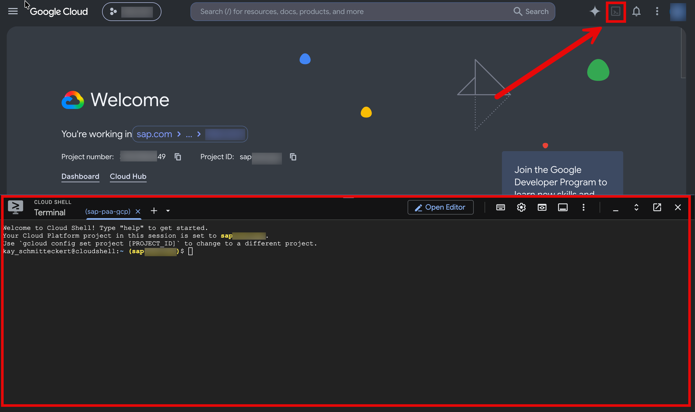
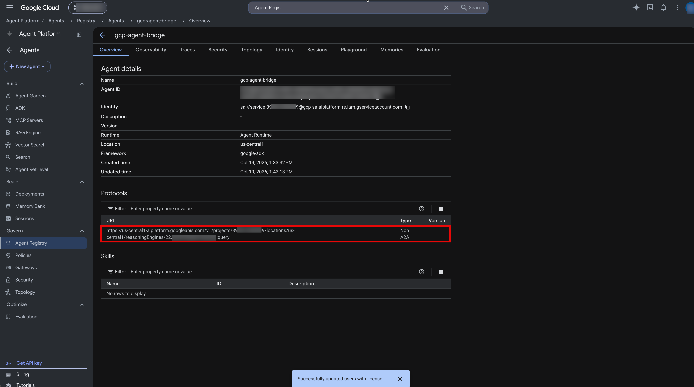
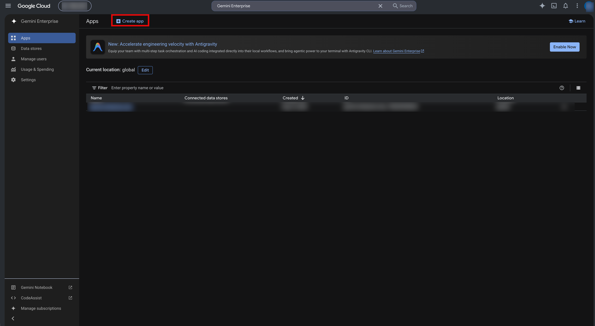
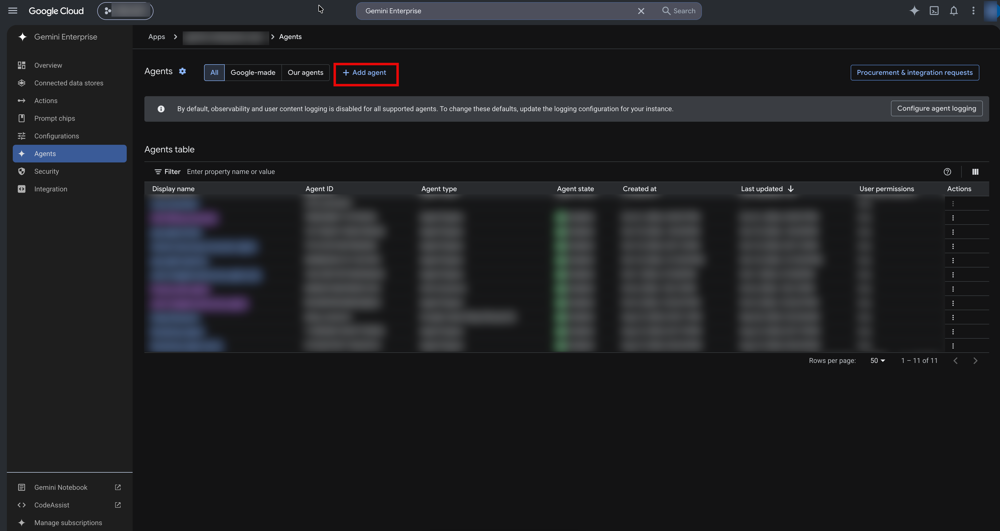
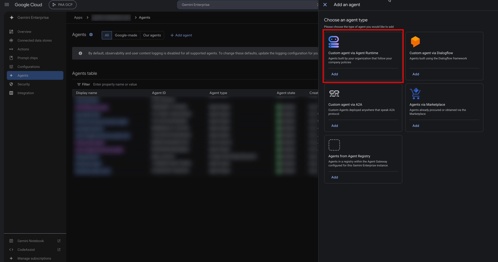
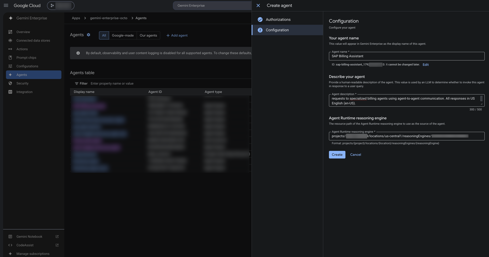

# Exercise 3 - Configure Connection from Gemini Enterprise Agent

In this exercise, you will deploy a bridge agent to Google's Agent Runtime that enables Gemini Enterprise to call your Joule agent through SAP's Agent Gateway using a three-legged OAuth flow.

Gemini Enterprise does support cross-provider three-legged authentication (3LO) with an in-chat sign-in prompt against SAP Cloud Identity Services (IAS). What neither Gemini Enterprise nor SAP offers out of the box is a token exchange that re-scopes the resulting end-user token to the SAP Agent Gateway. That second hop is why the bridge agent is needed. The bridge agent (`gcp-agent-bridge`) sits between Gemini Enterprise and the downstream A2A agent: it exchanges the end-user token forwarded by Gemini Enterprise at SAP Cloud Identity Services — authenticating itself with the application's client secret — for a downstream-scoped token, then relays the call over A2A.


The agent source lives in [`gcp-agent-bridge/`](./gcp-agent-bridge/). It is a transparent forwarding agent built on the Google ADK and deployed with `agents-cli`. See [`gcp-agent-bridge/README.md`](./gcp-agent-bridge/README.md) for the component-level reference. Because it is a full ADK agent, you could extend it with additional tools, sub-agents, or orchestration logic — for example, combining the SAP Joule agent with other Google or third-party agents to build richer, multi-step workflows.

### How the token exchange works

Understanding the flow makes the SAP Cloud Identity Services configuration below easier to follow:

1. Gemini Enterprise runs the end user's OAuth consent (using the authorization you register in Exercise 3.2) and forwards the resulting user token into the bridge agent's session state.
2. The agent reads that token and calls the SAP Cloud Identity Services token endpoint (`<OAUTH_TOKEN_HOST>/oauth2/token`) with `grant_type=urn:ietf:params:oauth:grant-type:jwt-bearer`, passing the forwarded user token as the `assertion` and the downstream resource as `resource`. This is RFC 7523 **jwt-bearer principal propagation**: SAP Cloud Identity Services re-mints the user token scoped to the downstream, preserving the user's `sub`.
3. The agent authenticates **itself** to SAP Cloud Identity Services with the application's `client_id` and `client_secret` (OAuth 2.0 client credentials, sent in the token request body).
4. The agent forwards the user's request to the downstream A2A agent (an `message/send` JSON-RPC call) with the exchanged token as a bearer token.

The client credentials prove *which app* is calling. The user identity is always the forwarded token, used verbatim — the agent can never choose an arbitrary user.

> All commands are given for Windows PowerShell. On a POSIX shell (bash/zsh), drop the trailing backtick (`` ` ``) line continuations or replace them with a backslash (`\`).

## Exercise 3.1 - Deploy Agent on Google's Agent Platform and Configure Connection to SAP's Agent Gateway

**Sign in to Google Cloud**

Confirm that you have completed all prerequisites before continuing using the Google Cloud CLI on your local machine or with Cloud Shell:



1. Sign in (**Note: not necessary with Cloud Shell**)


   ```
   gcloud auth login
   ```

   ```
   gcloud auth application-default login
   ```

2. Confirm you have a GCP project with the Vertex AI / Agent Engine APIs enabled. The agent is deployed to Google's Agent Runtime; no service account or key needs to be created — the bridge authenticates to SAP Cloud Identity Services with the application's client secret.

**Configure the SAP Cloud Identity Services Application**

> **Read-through only.** The steps below were already performed in advance for your workshop tenant — you are not expected (and will not have the access) to do them live. Read them to understand how the external agent's identity was established.

3. ✅ The redirect URIs for Gemini Enterprise have already been added to your SAP Cloud Identity Services application for you:

   - `https://vertexaisearch.cloud.google.com/oauth-redirect`
   - `https://vertexaisearch.cloud.google.com/static/oauth/oauth.html`

   

4. ✅ The SAP Cloud Identity Services application already has credentials. Use the same `client_id` and `client_secret` you used in the Bruno collection earlier. You will need them again in step 6 (`OAUTH_CLIENT_ID` / `OAUTH_CLIENT_SECRET`) and for the Gemini Enterprise authorization in Exercise 3.2.

**Configure and Deploy the Agent**

5. Change into the agent directory and copy the `.env` template:

   ```PowerShell
   cd ./exercises/ex3/gcp-agent-bridge
   cp env.example .env
   ```

6. Set the following variables in `.env`:

   | Variable | Required | Value |
   |---|---|---|
   | `MODEL` | No | Gemini model the agent runs on. Defaults to `gemini-3.8-flash`. |
   | `AGENT_NAME` | No | Defaults to `proxy_agent`. If you change it, also update `root_agent_name:` in `agents-cli-manifest.yaml` so telemetry stays consistent. |
   | `DOWNSTREAM_AGENT_URL` | Yes | The downstream A2A JSON-RPC endpoint — your Agent Gateway A2A URL for the Joule agent as used in Bruno `<joule_agent_a2a_server_url>` |
   | `OAUTH_CLIENT_ID` | Yes | The `client_id` from the `Gemini Enterprise Agent Gateway Consumer` as used in Bruno |
   | `OAUTH_CLIENT_SECRET` | Yes | The `client_secret` from the `Gemini Enterprise Agent Gateway Consumer` as used in Bruno |
   | `OAUTH_TOKEN_HOST` | Yes | The SAP Cloud Identity Services tenant base URL, e.g. `https://<tenant>.accounts400.ondemand.com` as used in Bruno `ias_host` |
   | `TOKEN_EXCHANGE_RESOURCE` | Yes | The resource/audience that identifies the downstream service to SAP Cloud Identity Services, for example `urn:sap:identity:application:provider:name:agent-gateway` as used in Bruno `agent_gateway_resource`|

7. Install the tooling, scaffold the deployment infrastructure (one time per project), and deploy:

    ```PowerShell
    pip install uv
    uv tool install google-agents-cli

    uv sync                          # resolves dependencies and generates uv.lock (the Docker build needs it)
    agents-cli deploy                # pass .env (including OAUTH_CLIENT_SECRET) to the runtime
    ```

    Make sure `OAUTH_CLIENT_SECRET` is passed to the deployed runtime — the agent uses the client secret to authenticate the client leg of the token exchange with SAP Cloud Identity Services.

## Exercise 3.2 - Connect Agent to Gemini Enterprise

Because the bridge authenticates to SAP Cloud Identity Services with the application's client secret, the deployed Agent Runtime identity needs no extra IAM grant — there is no service account to sign JWTs with.

1. Open the [Agent Registry](https://console.cloud.google.com/agent-platform/agent-registry/agents) in Google Cloud Console, find the deployed `gcp-agent-bridge` agent and **note the reasoning-engine URI** under **Protocols** in the following format:

   `projects/<project-number>/locations/<region>/reasoningEngines/<engine-number>`

   

2. Open [Gemini Enterprise](https://console.cloud.google.com/gemini-enterprise/apps) in Google Cloud Console and create an App.

   

3. Add the deployed agent. Select `Agents` &rarr; `Add agent` &rarr; `Custom agent via Agent Runtime` &rarr; `Add`.



4. Select `Add authorization` and enter the following values:

   | Variable | Value |
   |-|-|
   | `Authorization name` | XP268 |
   | `Client ID` | The `client_id` from the `Gemini Enterprise Agent Gateway Consumer` as used in Bruno |
   | `Client secret` | The `client_secret` from the `Gemini Enterprise Agent Gateway Consumer` as used in Bruno |
   | `Token URI` | `<ias_host>/oauth2/token` with `ias_host` as used in Bruno |
   | `Authorization URI` | `<ias_host>/oauth2/authorize?response_type=code&scope=openid` with `ias_host` as used in Bruno |
   | `PKCE verification enabled` | unchecked |
   | `Use HTTP Basic authentication` | unchecked |

   

5. Select `Next` and enter the following values:

   | Variable | Value |
   |-|-|
   | `Agent name` | SAP Billing Assistant |
   | `Agent description` | An intelligent billing assistant for SAP Quote-to-Cash (Q2C) operations with proactive workflow suggestions. Provides dynamic capabilities display, proactive next-step guidance, and routes requests to specialized billing agents using agent-to-agent communication. All responses in US English (en-US). |
   | `Agent Runtime reasoning engine` | Paste the URI noted in step 1, for example `projects/<project-number>/locations/<region>/reasoningEngines/<engine-number>`. |

   Select `Create`.

   

## Exercise 3.3 - Test End-to-End: Gemini Agent to AGW to Joule Agent

1. Open Gemini Enterprise and select the app you created in Exercise 3.2.

2. Send a message as in Bruno to the `SAP Billing Assistant` and verify that:
   - Gemini Enterprise prompts you to sign in with your SAP Cloud Identity Services credentials.
   - After authentication, the agent forwards your message through SAP's Agent Gateway to your Joule agent `SAP Billing Assistant`.
   - Your Joule agent's response is returned and displayed in Gemini Enterprise.

   If the agent replies that no credential was forwarded, confirm the authorization from Exercise 3.2 is attached and that consent completed. If the token exchange fails, re-check that `OAUTH_CLIENT_ID`, `OAUTH_CLIENT_SECRET`, `OAUTH_TOKEN_HOST`, and `TOKEN_EXCHANGE_RESOURCE` in the deployed runtime match the values from Bruno.

## Summary

You've now deployed the `gcp-agent-bridge` agent on Google's Agent Platform, configured the three-legged OAuth flow between Gemini Enterprise and SAP Cloud Identity Services, and validated the end-to-end call chain from Gemini Enterprise through SAP's Agent Gateway to your Joule agent.
