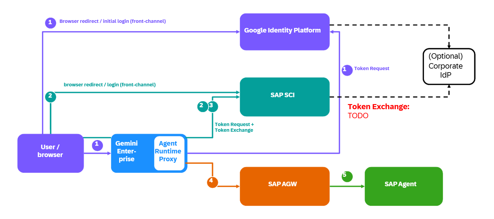

# Exercise 3 - Configure Connection from Gemini Enterprise Agent

In this exercise, you will deploy a proxy agent to Google's Agent Runtime that enables Gemini Enterprise to call your custom Joule agent through SAP's Agent Gateway using a three-legged OAuth flow.

Gemini Enterprise cannot connect directly to an SAP agent through SAP Agent Gateway because it does not support cross-provider A2A authentication with an in-product sign-in prompt. The proxy agent (GCP-Agent-Generic) sits between Gemini Enterprise and the downstream A2A agent: it exchanges the end-user token forwarded by Gemini Enterprise at SAP IAS for a downstream-scoped token, then relays the call over A2A.



> All commands are given for Windows PowerShell.

## Exercise 3.1 - Deploy Agent on Google's Agent Platform and Configure Connection to SAP's Agent Gateway

**Create a Google Cloud Service Account**

Confirm that you have completed all prerequisites before continuing.

1. Sign in using the Google Cloud CLI.

   ```
   gcloud auth login
   ```

   ```
   gcloud auth application-default login
   ```

2. Enable the IAM Service Account Credentials API. For reference, see the [IAM Credentials API documentation](https://docs.cloud.google.com/iam/docs/reference/credentials/rest).

   ```
   gcloud services enable iamcredentials.googleapis.com --project <your-project-id>
   ```

3. Create a Google Cloud service account. You can change the `sap-ias-signer` account ID and display name as needed.

   ```
   gcloud iam service-accounts create sap-ias-signer --project <your-project-id> `
     --display-name "SAP IAS client-assertion signer"
   ```

4. Verify that the service account creation was successful.

   ```
   gcloud iam service-accounts list --project <your-project-id> `
     --format="table(displayName, email, disabled)"

   # Expected Output:
   # DISPLAY NAME                                         EMAIL                                                               DISABLED
   # SAP IAS client-assertion signer                      sap-ias-signer@<your-project-id>.iam.gserviceaccount.com             False
   ```

   The resulting principal is `sap-ias-signer@<your-project-id>.iam.gserviceaccount.com`. Use it later to configure the GCP-Agent-Generic `RUNTIME_SA_EMAIL`.

**Configure the SAP IAS Application**

5. Add the following redirect URIs under `Applications & Resources` &rarr; `<your-application>` &rarr; `OpenID Connect Configuration` &rarr; `Redirect` &rarr; `Add`:

   - `https://vertexaisearch.cloud.google.com/oauth-redirect`
   - `https://vertexaisearch.cloud.google.com/static/oauth/oauth.html`

6. Create credentials under `Applications & Resources` &rarr; `<your-application>` &rarr; `Client Authentication` &rarr; `Secrets` &rarr; `Add`. Add a description, select `Application` and `OpenID`, and click `Save`.

   **Note down the shown credentials!**

7. Add the previously configured service account under `Applications & Resources` &rarr; `<your-application>` &rarr; `Client Authentication` &rarr; `JSON Web Tokens` &rarr; `Configure Trust by Issuer` &rarr; `Add`. Complete the fields as follows:

   | Variable | Value |
   |-|-|
   | `Description` | Enter a description. |
   | `Issuer Configuration` | Manual Configuration |
   | `Issuer` | `https://www.googleapis.com/service_accounts/v1/jwk/<RUNTIME_SA_URI>` |
   | `JSON Web Key Set URI` | `https://www.googleapis.com/service_accounts/v1/jwk/<RUNTIME_SA_URI>` |
   | `Refresh Interval` | 24 hours |
   | `Corporate Identity Provider - Name` | **Leave blank!** |
   | `Subject` | Client ID from the credentials created previously. |
   | `Audience` | The SAP IAS tenant base URL, e.g. `https://<tenant>.accounts400.ondemand.com` |
   | `API Permission Groups` | **Leave blank!** |

   Save the configuration.

**Configure and Deploy GCP-Agent-Generic**

8. Copy the `.env` template:

   ```PowerShell
   cp env.example .env
   ```

9. Set the following variables:

   | Variable | Required | Value |
   |---|---|---|
   | `MODEL` | No | For example, `gemini-3.8-flash`. |
   | `AGENT_NAME` | Yes | For example, `gcp_agent_generic`, you also need to adjust this in the `agents-cli-manifest.yaml`! |
   | `DOWNSTREAM_AGENT_URL` | Yes | The downstream A2A JSON-RPC endpoint or the Agent Gateway A2A URL. |
   | `OAUTH_CLIENT_ID` | Yes | The `client_id` of the **SAP IAS application** configured above. |
   | `OAUTH_TOKEN_HOST` | Yes | The SAP IAS tenant base URL, for example `https://<tenant>.accounts400.ondemand.com`. |
   | `TOKEN_EXCHANGE_RESOURCE` | Yes | The resource or audience that identifies the downstream service to IAS, for example `urn:sap:identity:application:provider:name:agent-gateway`. |
   | `RUNTIME_SA_EMAIL` | Yes | The email of the GCP service account created above, for example `<sa>@<project>.iam.gserviceaccount.com`. |
   | `GE_AUTH_ID` | No | Set this only when more than one Gemini Enterprise authorization is registered on the agent; it selects the forwarded token to read. |

10. Open the GCP-Agent-Generic directory, install dependencies, and deploy:

    ```
    cd ./<path-on-your-machine>/gcp-agent-generic/
    pip install uv
    uv tool install google-agents-cli
    uv sync                          # generates uv.lock (Docker build needs it)
    agents-cli deploy                # pass .env to the runtime; do NOT set a client secret
    ```

## Exercise 3.2 - Connect Agent to Gemini Enterprise

1. Open the deployed agent in the Agent Registry and copy the identity service account email. It looks like:

   `<service-account>@gcp-sa-aiplatform-re.iam.gserviceaccount.com`

2. Grant the service account permission to create credentials.

   ```
   gcloud iam service-accounts add-iam-policy-binding `
     sap-ias-signer@<your-project-id>.iam.gserviceaccount.com `
     --member "<service-account>@gcp-sa-aiplatform-re.iam.gserviceaccount.com" `
     --role roles/iam.serviceAccountTokenCreator `
     --project <your-project-id>
   ```

3. Verify the policy binding.

   ```
   gcloud iam service-accounts get-iam-policy `
     sap-ias-signer@<your-project-id>.iam.gserviceaccount.com `
     --project <your-project-id> `
     --format="table(bindings.role, bindings.members)"

   # Expected Output
   # ROLE                                      MEMBERS
   # ['roles/iam.serviceAccountTokenCreator']  [['serviceAccount:sap-ias-signer@<your-project-id>.iam.gserviceaccount.com']]
   ```

   *Optional: Add yourself as a member for local testing.*

   ```
   gcloud iam service-accounts add-iam-policy-binding `
     sap-ias-signer@<your-project-id>.iam.gserviceaccount.com `
     --member "user:<your-email>" `
     --role roles/iam.serviceAccountTokenCreator `
     --project <your-project-id>
   ```

4. Open the Agent Registry in Google Cloud Console, find the deployed GCP-Agent-Generic, and note the URI under **Protocols** in the following format:

   `projects/<project-number>/locations/<region>/reasoningEngines/<engine-number>`

5. Open Gemini Enterprise in Google Cloud Console, create an app, and add the deployed agent. Select `Agents` &rarr; `Add agent` &rarr; `Custom agent via Agent Runtime` &rarr; `Add`.

6. Select `Add authorization` and enter the following values:

   | Variable | Value |
   |-|-|
   | `Authorization name` | Enter a name of your choice. |
   | `Client ID` | The `client_id` of the **SAP IAS application** configured in Exercise 3.1. |
   | `Client secret` | The `client_secret` of the **SAP IAS application** configured in Exercise 3.1. |
   | `Token URI` | `https://<tenant>.accounts400.ondemand.com/oauth2/token` |
   | `Authorization URI` | `https://<tenant>.accounts400.ondemand.com/oauth2/authorize?response_type=code&scope=openid` |
   | `PKCE verification enabled` | unchecked |
   | `Use HTTP Basic authentication` | unchecked |

7. Select `Next` and enter the following values:

   | Variable | Value |
   |-|-|
   | `Agent name` | Enter a name of your choice. |
   | `Agent description` | Enter a description, for example: "Proxy agent that forwards requests to an SAP agent through SAP Agent Gateway." |
   | `Agent Runtime reasoning engine` | Paste the URI noted above, for example `projects/<project-number>/locations/<region>/reasoningEngines/<engine-number>`. |

   Select `Create`.

## Exercise 3.3 - Test End-to-End: Gemini Agent to AGW to Custom Agent

1. Open Gemini Enterprise and select the app you created in Exercise 3.2.

2. Send a message to the agent and verify that:
   - Gemini Enterprise prompts you to sign in with your SAP IAS credentials.
   - After authentication, the agent forwards your message through SAP's Agent Gateway to your custom Joule agent.
   - Your custom Joule agent's response is returned and displayed in Gemini Enterprise.

## Summary

You've now deployed the GCP-Agent-Generic proxy on Google's Agent Platform, configured the three-legged OAuth flow between Gemini Enterprise and SAP IAS, and validated the end-to-end call chain from Gemini Enterprise through SAP's Agent Gateway to your custom Joule agent.
